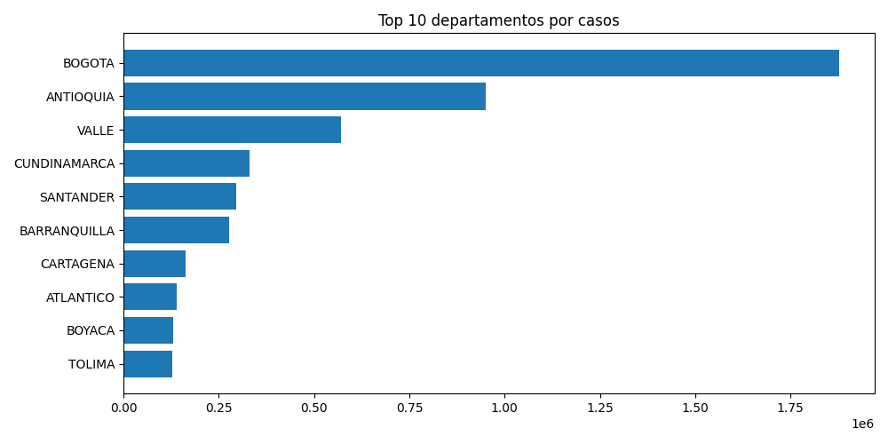
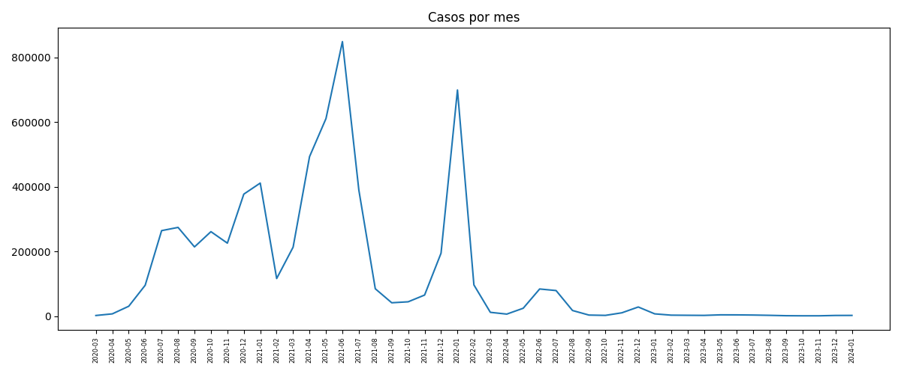
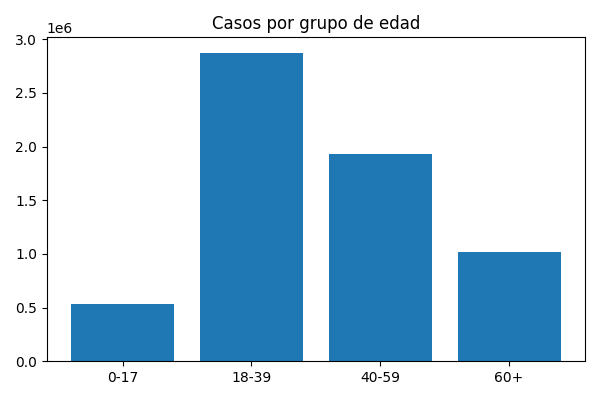

# Procesamiento batch de casos de COVID-19 en Colombia con Apache Spark

**Universidad Nacional Abierta y a Distancia (UNAD)**
**Curso:** Big Data (código 202016911)
**Grupo:** 202016911_13
**Autor:** Luis Gabriel Balmaceda Ortega
**Actividad:** Tarea 3 - Procesamiento de Datos con Apache Spark

---

## 1. Descripción del problema

Durante la pandemia, las autoridades de salud necesitaron entender cómo se distribuían los contagios en el territorio y entre la población. Este proyecto responde, con procesamiento distribuido en Apache Spark, a las siguientes preguntas:

- ¿Qué departamentos y ciudades concentran más casos?
- ¿Cómo se distribuyen los casos por sexo y por grupo de edad?
- ¿Cuál fue la gravedad de los casos (leve, moderado, grave, fallecido)?
- ¿Cómo evolucionaron los casos mes a mes?

## 2. Dataset

- **Nombre:** Casos positivos de COVID-19 en Colombia
- **Fuente:** Portal de Datos Abiertos de Colombia (datos.gov.co), Ministerio de Salud / INS
- **Identificador:** gt2j-8ykr
- **Tamaño:** ~1.2 GB, 6.39 millones de líneas y 23 columnas
- **Formato:** CSV

Columnas principales usadas: `ID de caso`, `Fecha de notificación`, `Nombre departamento`, `Edad`, `Unidad de medida de edad`, `Sexo` y `Estado`.

Descarga:

```bash
wget -O covid_colombia.csv "https://www.datos.gov.co/api/views/gt2j-8ykr/rows.csv?accessType=DOWNLOAD"
```

El CSV no se incluye en el repositorio por su tamaño (supera el límite de 100 MB de GitHub).

## 3. Qué hace el script (`batch_covid.py`)

1. **Carga:** lee el CSV con Spark y normaliza los nombres de las columnas (minúsculas, sin tildes ni espacios).
2. **Limpieza y transformación:**
   - Elimina duplicados usando `id_de_caso`.
   - Conserva solo registros con edad en años (`unidad_de_medida_de_edad = 1`) y entre 0 y 110.
   - Descarta registros sin departamento o sin fecha de notificación.
   - Estandariza `sexo` y `estado`, y convierte la fecha a tipo fecha.
   - Crea la columna `grupo_edad` (0-17, 18-39, 40-59, 60+).
3. **Análisis exploratorio (EDA):** casos por departamento (top 10), sexo, estado y estadísticas de edad (promedio, desviación, mínimo y máximo).
4. **Visualización:** genera tres gráficas en PNG.

## 4. Requisitos

- Ubuntu 22.04 (máquina virtual VirtualBox)
- Java 11
- Apache Spark 3.5.3
- Python 3 con `pandas` y `matplotlib`

## 5. Ejecución

```bash
pip install matplotlib pandas
wget -O covid_colombia.csv "https://www.datos.gov.co/api/views/gt2j-8ykr/rows.csv?accessType=DOWNLOAD"
spark-submit --driver-memory 2g batch_covid.py
```

Si hay poca memoria, usa una muestra:

```bash
head -n 2000000 covid_colombia.csv > covid_2M.csv
```

y cambia el nombre del archivo en el script.

## 6. Resultados obtenidos

| Indicador | Valor |
|---|---|
| Filas cargadas | ~6.39 millones |
| Filas después de limpiar | 6 357 461 |
| Mujeres / Hombres | 3 402 159 / 2 955 302 |
| Edad promedio | 40.2 años (desv. 18.4) |
| Casos leves | 6 172 634 |
| Fallecidos | 142 999 |

Top 5 de departamentos por casos: Bogotá (1 877 427), Antioquia (950 334), Valle (569 877), Cundinamarca (329 469) y Santander (296 498).

Nota: en el dataset original Barranquilla, Cartagena y otras ciudades aparecen como "departamentos" separados de su departamento (por ejemplo, Atlántico).

## 7. Gráficas generadas

- `grafica_departamentos.png`: top 10 de departamentos por casos.
- `grafica_casos_mes.png`: evolución mensual de los casos.
- `grafica_edad.png`: casos por grupo de edad.





## 8. Procesamiento en tiempo real

La parte de streaming (Apache Kafka + Spark Streaming con el topic `sensor_data`) se desarrolló siguiendo el Anexo 3 y se muestra en el video de la actividad.

## 9. Autor

Luis Gabriel Balmaceda Ortega, Grupo 202016911_13, UNAD.
